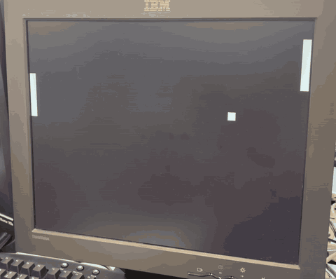
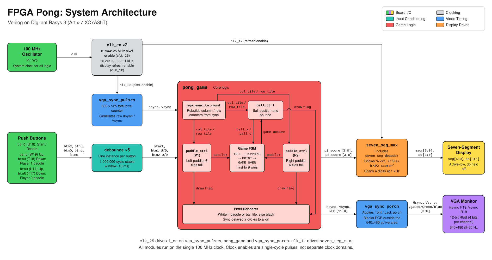
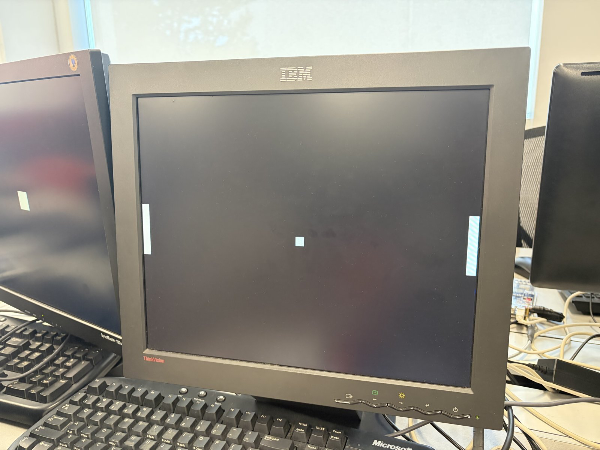

<h1 align="center">FPGA Pong</h1>

<p align="center">Two-player Pong in Verilog on a Basys 3, driving VGA and the seven-segment display.</p>

<p align="center">
  
</p>

<p align="center"><em>Running on real hardware: Basys 3 driving a VGA monitor at 640x480.</em></p>

## Contents

<div align="center">

| Section | What's in it |
|:---:|:---:|
| [Overview](#overview) | What this is and what I added to the tutorial |
| [Results at a glance](#results-at-a-glance) | Resolution, resources, timing and tests |
| [Architecture](#architecture) | Block diagram and what each module does |
| [Design decisions and trade-offs](#design-decisions-and-trade-offs) | What I chose, what I passed on, and what it cost |
| [Verification](#verification) | Six testbenches and hardware testing |
| [Build progression](#build-progression) | Resources and timing at every milestone |
| [Controls](#controls) | Button mapping and game flow |
| [Build and run](#build-and-run) | Vivado steps and saving reports |
| [Repo layout](#repo-layout) | Where everything lives |
| [Acknowledgements](#acknowledgements) | Nandland and Digilent |

</div>

## Overview

FPGA Pong is a two-player Pong game written in Verilog for the Digilent Basys 3 (Artix-7 XC7A35T). It draws the paddles and ball on a VGA monitor at 640x480 and keeps score on the board's seven-segment display.

I started from the Nandland Go Board Pong tutorial (Projects 9 and 10), ported it to Vivado and the Basys 3, and extended it: one 100 MHz clock with clock enables instead of a separate pixel clock, a synchronizer and debouncer on all five buttons, a multiplexed four-digit scoreboard, six testbenches, and utilization and timing reports saved at every milestone.

The biggest lessons were about latency and clocking. Every register stage costs a cycle that sync has to match, and clock enables let a whole design live in one clock domain.

## Results at a glance

<div align="center">

| Metric | Value |
|:---:|:---:|
| Resolution | 640x480 VGA |
| Pixel rate | 25 MHz enable from the 100 MHz clock |
| Refresh rate | About 59.5 Hz (25 MHz / (800 x 525)) |
| Slice LUTs | 259 of 20,800 (1.25%) |
| Flip-flops | 327 of 41,600 (0.79%) |
| Latches | 0 |
| BRAM / DSP | 0 / 0 |
| Clocking | 1 BUFG, no MMCM or PLL |
| I/O | 32 pins |
| Setup slack (WNS) | +5.011 ns at 100 MHz |
| Hold slack (WHS) | +0.122 ns |
| Failing endpoints | 0 of 700 |
| Testbenches | 6 (4 self-checking, all passing) |
| Hardware | Full game tested on a Basys 3 with a VGA monitor |

</div>

Resource and timing numbers come from the routed design in [reports/05_final_pong](reports/05_final_pong).

## Architecture

<p align="center">
  <a href="docs/pong_architecture.png"></a>
</p>

<p align="center"><em>Click the diagram for the full-size version.</em></p>

Everything runs on the 100 MHz board clock. `clk_en` makes a 25 MHz pixel enable and a 1 kHz display enable. `vga_sync_pulses` owns the frame timing, `pong_game` rebuilds its own pixel counters from sync and decides the color of every pixel, and `vga_sync_porch` turns the timing into real VGA sync pulses on the way out. The scores go to `seven_seg_mux`, which scans the four digits.

<div align="center">

| Module | Role | Key detail |
|:---:|:---:|:---:|
| [`pong_top`](rtl/pong_top.v) | Top level | Connects the board pins and maps the five buttons to game inputs |
| [`clk_en`](rtl/clk_en.v) | Clock enable generator | One-cycle pulse every DIV clocks. DIV = 4 gives 25 MHz, DIV = 100,000 gives 1 kHz |
| [`debounce`](rtl/debounce.v) | Button conditioning | 2-flop `ASYNC_REG` synchronizer, then 1,000,000 stable cycles (10 ms) before the output changes. One per button |
| [`vga_sync_pulses`](rtl/vga_sync_pulses.v) | Frame timing source | Counts the 800 x 525 frame. Its hsync and vsync are high during the visible 640x480 |
| [`vga_sync_to_count`](rtl/vga_sync_to_count.v) | Counter rebuild | Recovers column and row counts from hsync and vsync, resetting on the rising edge of vsync |
| [`pong_game`](rtl/pong_game.v) | Game core and renderer | 40 x 30 grid of 16 px tiles, game FSM, scoring, white or black pixels, sync delayed 2 cycles |
| [`paddle_ctrl`](rtl/paddle_ctrl.v) | One paddle | 6 tiles tall, moves one tile per 1,000,000 enables (40 ms) while held, clamped at the edges |
| [`ball_ctrl`](rtl/ball_ctrl.v) | Ball motion | One diagonal tile step per 1,250,000 enables (50 ms), bounces at rows 0 and 29 and columns 1 and 38 |
| [`vga_sync_porch`](rtl/vga_sync_porch.v) | Output stage | Cuts the real active-low sync pulses and delays RGB 2 cycles to stay aligned |
| [`seven_seg_mux`](rtl/seven_seg_mux.v) | Scoreboard driver | Steps through the four digits at 1 kHz, showing A, P1 score, b, P2 score |
| [`seven_seg_decoder`](rtl/seven_seg_decoder.v) | Hex to segments | Active-low segment patterns for 0 to F |
| [`test_pattern`](rtl/test_pattern.v) | Bring-up pattern | Color bars for the first VGA milestone, not in the final build |
| [`vga_params.vh`](rtl/vga_params.vh) | Shared constants | VGA timing and grid sizes as `` `define `` macros with an include guard |

</div>

## Design decisions and trade-offs

A few of these came with the tutorial and I kept them. The rest I made while porting and extending it. For each one: what I chose, what I passed on, and what it cost.

<div align="center">

| Decision | Chose | Over | Main reason |
|:---:|:---:|:---:|:---:|
| Timing between stages | Sync-based stages | One central timing generator | Each stage stands alone, like a real video link |
| Clocking | One 100 MHz clock with enables | An MMCM or a divided clock | One clock domain on one BUFG |
| Position resolution | 16 px tiles | Per-pixel positions | 5 and 6-bit compares instead of 10-bit |
| Rendering | Draw flags only | A renderer that reads game state | Game rules can't break video timing |
| Ball and scoring | Ball always bounces, scoring is separate | A paddle check inside `ball_ctrl` | Simple ball module, scoring in one place |
| Reset | Power-on initial values | A global reset input | No reset net routed to every flop |
| Button inputs | Synchronizer plus 10 ms debounce | Debouncing the raw pin | The async input never reaches the counter |
| Shared constants | `` `define `` macros in a header | Root-scope localparams | xsim rejected localparams outside a module |
| Score limit | 9 | A higher limit | One decimal digit per score, no BCD |

</div>

### Sync-based stages instead of a central timing generator

I kept the tutorial's structure here. `vga_sync_pulses` is the only module that owns the frame timing. Every stage after it gets just hsync and vsync, rebuilds its own column and row counters with `vga_sync_to_count`, and passes sync along with its pixels. That mirrors a real video link, where the monitor only ever sees sync, and it keeps each stage self-contained. When the game replaced the test pattern at the last milestone, `pong_game` dropped into the same slot between `vga_sync_pulses` and `vga_sync_porch`, and neither of those needed a functional change.

The alternative is one central generator that sends the column count, row count and a display-active flag to every stage. That would be simpler and smaller. My version pays twice. The final build carries three copies of the 10-bit column and row counters, and I have to track latency by hand: `vga_sync_to_count` adds a cycle and the registered RGB adds another, so `pong_game` delays hsync and vsync by 2 cycles to keep them lined up with the pixels.

### One 100 MHz clock with enables instead of an MMCM or a divided clock

Everything runs on the 100 MHz board clock. `clk_en` produces single-cycle enable pulses, one every 4 clocks for the 25 MHz pixel rate and one every 100,000 clocks for the 1 kHz display scan. The whole design sits in one clock domain on one BUFG, so there are no internal clock domain crossings, and the buttons are the only asynchronous inputs. I never drive logic from a clock divided down in fabric, because that clock runs on general routing with poor skew and becomes a second domain with its own constraints and crossings.

The cost is the pixel rate. 100 MHz / 4 is exactly 25 MHz instead of the standard 25.175 MHz, so the frame rate is 25 MHz / (800 x 525) = about 59.5 Hz, not 59.94 Hz. Monitors accept it, including the one in the demo. An MMCM could get much closer to 25.175 MHz, but it would add a second clock domain next to the 100 MHz logic. The enables also show up in timing: the worst setup path in the final build starts at the 25 MHz enable flop, which fans out to 138 loads, and it still has 5.011 ns of slack.

### 16 px tiles instead of per-pixel positions

The playfield is a 40 x 30 grid of 16 px tiles. Dropping the low 4 bits of the pixel counters gives a 6-bit tile column and a 5-bit tile row, so every paddle and ball comparison is 5 or 6 bits wide instead of 10, and positions fit in small registers. Per-pixel positions would allow smooth motion and any object size, but every comparator and position register would get wider. The cost is coarse motion: the ball covers 20 tiles a second, but in 16 px jumps.

One catch: rows 512 to 524 wrap back to tile row 0 in 5 bits, so the renderer gates every draw flag with an active-area check. `tb_pong_game` tests that gate by parking a paddle in tile row 0 and counting the white pixels over a full frame.

### Video that ignores game state

The renderer in `pong_game` looks at four signals: the active-area flag and the draw flags from the two paddles and the ball. Each object module decides whether it covers the current tile, and the renderer ORs the answers into white or black. It never reads the FSM, so changing the game rules can't break the video timing. The alternative is a renderer that knows the game state, which is what a game-over screen or an on-screen score would need. That's the cost: the monitor only ever shows the paddles and the ball, and the score lives on the seven-segment display.

### A ball that always bounces, with scoring checked separately

`ball_ctrl` reflects the ball at columns 1 and 38 every time, just in front of the paddles, without knowing where the paddles are. Scoring lives in `pong_game`. `arrive_left` and `arrive_right` pulse for one enable cycle when the ball first reaches column 1 or 38, and at that moment `pong_game` checks whether the defending paddle covers the ball's row. A miss sends the FSM to `POINT`, which pulls the ball back to the center before it can bounce away.

The alternative is a paddle check inside `ball_ctrl` that only bounces on a hit. Keeping them apart made `ball_ctrl` a plain bouncing-ball module I could test on its own, and put all the scoring rules in one place. Checking only on arrival also means a paddle that slides away while the ball sits at the wall can't cause a late point, which `tb_pong_game` checks. The cost is that the paddle has no say in the bounce angle, since `ball_ctrl` never learns where it hit.

### Power-on initial values instead of a reset input

There's no reset button and no reset net. Every register gets its starting value from an initial value in its declaration, Vivado turns that into the flip-flop's INIT value, and the FPGA loads it during configuration. That works on Xilinx parts and saves routing a reset to every flop. The alternative is a proper reset input, synchronized and fanned out to everything. Skipping it costs portability, since ASIC flows ignore initial values and the design would power up in an unknown state there. It also means the only full reset is reconfiguring the FPGA. This is the first decision I'd revisit.

### A synchronizer and a 10 ms debounce on every button

The buttons are asynchronous to the 100 MHz clock, so each one goes through a 2-flop synchronizer marked `ASYNC_REG` before anything else sees it. `ASYNC_REG` tells Vivado to place the pair close together and keep it intact through optimization. In the routed build the `btnC` pair sits in a single slice, which is also why it's the worst hold path at +0.122 ns: the wire between the two flops is about as short as it gets. After the synchronizer, a counter has to see the new level for 1,000,000 consecutive cycles (10 ms at 100 MHz) before the output changes.

Debouncing the raw pin would save two flops per button, but then an asynchronous signal feeds the counter logic directly, where a metastable sample or two flops disagreeing about the same edge can cause trouble. The cost of my version is five independent 20-bit counters. The 1 kHz enable I already generate for the display could act as a shared sample tick and shrink each counter to 4 bits.

### Macros in a shared header instead of localparams

The VGA timing and grid constants live in `vga_params.vh`. The grid constants also size the tile ports on `ball_ctrl` and `paddle_ctrl`, so every file that needs them includes the header above its module line, at file scope. Plain localparams didn't work there: xsim rejected them, since Verilog-2001 only allows a localparam inside a module. `` `define `` macros with an include guard work in both synthesis and simulation.

The cost is that macros are global and unscoped. Every `` `define `` shares one namespace across the whole compile, and unlike parameters they can't be overridden per instance. To guard against the other classic Verilog trap, every RTL and testbench file sets `` `default_nettype none ``, so a mistyped signal name is a compile error instead of a silent new 1-bit wire.

### A score limit of 9

First to 9 wins. Each score is always a single decimal digit, so the 4-bit score register feeds the hex decoder directly with no binary-to-BCD conversion, and each player needs only one of the four digits. That leaves room for the A and b labels. The cost is short games. A higher limit as it stands would show 10 as A, which is already player 1's label, so doing it properly means a BCD converter, two digits per player, and losing the labels.

## Verification

I wrote a testbench for each stage as I built it. The first two are waveform benches that I checked by eye. From the debouncer on, every bench is self-checking: it compares outputs against expected values, counts errors, and prints TEST PASSED or TEST FAILED. They swap the real delays for short ones (2 to 20 cycles) so they finish quickly, and all four self-checking benches pass in xsim.

<div align="center">

| Testbench | Covers | What it checks | Type |
|:---:|:---:|:---:|:---:|
| [`tb_vga_sync`](tb/tb_vga_sync.v) | The whole VGA chain with `test_pattern` | Runs 20 ms, more than one 16.8 ms frame, to inspect the counters, sync pulses and RGB alignment | Waveform |
| [`tb_seven_seg_mux`](tb/tb_seven_seg_mux.v) | `seven_seg_decoder` and `seven_seg_mux` | Decoder patterns for 0 to F, scanning across four digit patterns, then blanking the middle two digits | Waveform |
| [`tb_debounce`](tb/tb_debounce.v) | `debounce` | Exact press and release latency, bouncy presses and releases, and a short glitch while held that must be ignored | Self-checking |
| [`tb_paddle_ctrl`](tb/tb_paddle_ctrl.v) | `paddle_ctrl` | Start position, exact move timing, counter restart on release, both buttons held, top and bottom clamps, and the draw flag on every row | Self-checking |
| [`tb_ball_ctrl`](tb/tb_ball_ctrl.v) | `ball_ctrl` | Serve timing and direction, 120 moves of single-tile diagonal steps, all four walls reached, freezing with the enable low, a full 40 x 30 draw sweep, and the snap back to center | Self-checking |
| [`tb_pong_game`](tb/tb_pong_game.v) | `pong_game` with the real `vga_sync_pulses` | Misses by both players, a hit, arrival-only scoring, start edge detection, the score limit to `GAME_OVER` and back, and exactly 3,328 white pixels per frame | Self-checking |

</div>

The pixel count in `tb_pong_game` is one 16 x 16 ball plus two 16 x 96 paddles. A stray pixel in the blanking interval, or any color other than black or white, fails the test.

### Hardware

I tested the full game on the Basys 3 with a VGA monitor. Before that, I verified the VGA color-bar pattern and the seven-segment display on hardware during the earlier milestones.

<p align="center">
  
</p>

## Build progression

I saved the routed utilization and timing reports at every milestone with [`scripts/save_reports.tcl`](scripts/save_reports.tcl), so each folder in [`reports/`](reports) is a snapshot of the design at that point.

<div align="center">

| Milestone | What the build contained | LUTs | FFs | WNS |
|:---:|:---:|:---:|:---:|:---:|
| `01_vga_test_pattern` | 25 MHz enable, VGA pipeline and color-bar test pattern | 69 | 86 | +5.159 ns |
| `02_seven_seg` | Adds the 1 kHz enable and the seven-segment mux, with digits set by the slide switches | 84 | 117 | +5.381 ns |
| `03_debounce` | Adds one debounced button, with `btnC` presses counted on the display | 96 | 149 | +5.300 ns |
| `04_paddle_ctrl` | Same top level as 03 | 96 | 149 | +5.300 ns |
| `05_final_pong` | Full game: `pong_game`, five debounced buttons and the score display | 259 | 327 | +5.011 ns |

</div>

Milestone 04 matches 03 exactly because `paddle_ctrl` was only verified in simulation at that point and wasn't wired into the top level yet. The jump at 05 is the game itself (both paddles, the ball, the FSM and four more debouncers), and setup slack stayed above 5 ns at 100 MHz the whole way.

## Controls

The mapping lives in [`pong_top.v`](rtl/pong_top.v). Each player uses a pair of neighboring buttons on the cross-shaped pad.

<div align="center">

| Button | Pin | Action |
|:---:|:---:|:---:|
| `btnC` | U18 | Serve, and restart after a game ends |
| `btnL` | W19 | Player 1 (left paddle) up |
| `btnU` | T18 | Player 1 (left paddle) down |
| `btnD` | U17 | Player 2 (right paddle) up |
| `btnR` | T17 | Player 2 (right paddle) down |

</div>

Holding a paddle button moves the paddle 25 tiles per second, and holding both of a player's buttons keeps it still. Each point starts with the ball at the center, waiting for `btnC`. The start input is edge-detected, so holding `btnC` down doesn't serve again after a point. When a player reaches 9, the game stops in `GAME_OVER` with the final score showing. One press clears the scores and the next one serves. The display reads A, player 1's score, b, player 2's score, from left to right.

## Build and run

I built this with Vivado 2025.2. The repo doesn't track the Vivado project, so a fresh clone starts with a new one.

1. Create a new RTL project for the `xc7a35tcpg236-1` (the Basys 3 part). Make the project directory a `vivado/` folder at the repo root. That folder is in `.gitignore`, and `save_reports.tcl` writes to `../reports` relative to the project directory.
2. Add every file in `rtl/` as a design source, including `vga_params.vh`. Leave "Copy sources into project" unchecked so the project points at the repo files.
3. Add `constr/basys3_pong.xdc` as the constraints file.
4. In the Sources window, right-click `pong_top` and choose Set as Top.
5. Click Generate Bitstream. Vivado runs synthesis and implementation first.
6. Connect the Basys 3 over USB and a monitor to its VGA port. Open the Hardware Manager, choose Open Target, then Auto Connect, and program the device with `pong_top.bit`.

To run the testbenches, add the files in `tb/` as simulation sources, set one as the simulation top, run Behavioral Simulation, and click Run All. Each bench stops itself when it's done, and the self-checking ones print their result in the Tcl console.

After implementation, I open the implemented design and save the reports from the Tcl console. On my machine the repo is at `C:/pong`:

```tcl
source C:/pong/scripts/save_reports.tcl
save_reports 05_final_pong
```

`save_reports` writes `util.rpt` and `timing.rpt` into a folder under `reports/` named after the milestone.

## Repo layout

```text
.
├── constr/                    Basys 3 pin and clock constraints
├── docs/                      Block diagram, demo GIF and monitor photo
├── reports/                   Routed utilization and timing reports per milestone
├── rtl/
│   ├── pong_top.v             Top level and button mapping
│   ├── pong_game.v            Game FSM, scoring and pixel renderer
│   ├── paddle_ctrl.v          One paddle
│   ├── ball_ctrl.v            Ball motion and wall bounces
│   ├── clk_en.v               Clock enable pulses
│   ├── debounce.v             Synchronizer and debouncer
│   ├── vga_sync_pulses.v      Frame timing source
│   ├── vga_sync_to_count.v    Rebuilds counters from sync
│   ├── vga_sync_porch.v       Real sync pulses and RGB alignment
│   ├── seven_seg_mux.v        Four-digit display scanning
│   ├── seven_seg_decoder.v    Hex to seven segments
│   ├── test_pattern.v         Color bars from the first milestone
│   └── vga_params.vh          Shared timing and grid macros
├── scripts/                   Vivado Tcl scripts, including save_reports.tcl
└── tb/                        Six testbenches, four of them self-checking
```

## Acknowledgements

- [Nandland](https://nandland.com) Go Board Projects 9 and 10. This design started from that Pong tutorial, and its structure follows it: the sync pulses, sync-to-count and porch pipeline, and separate paddle and ball controllers.
- The Digilent Basys 3 Reference Manual, for the board pinout and the VGA, seven-segment and button circuits.
